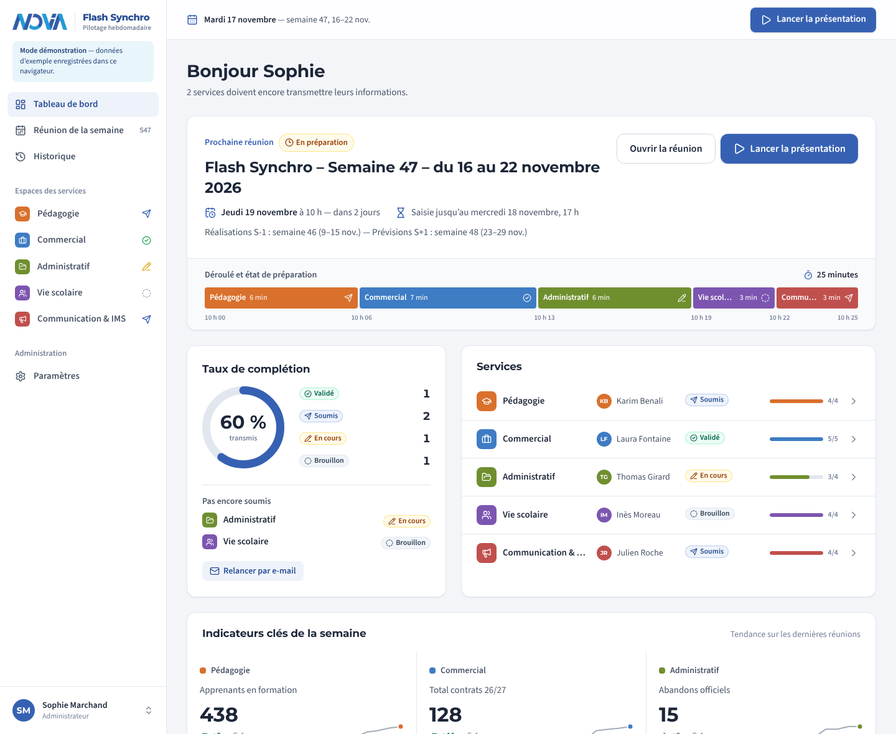
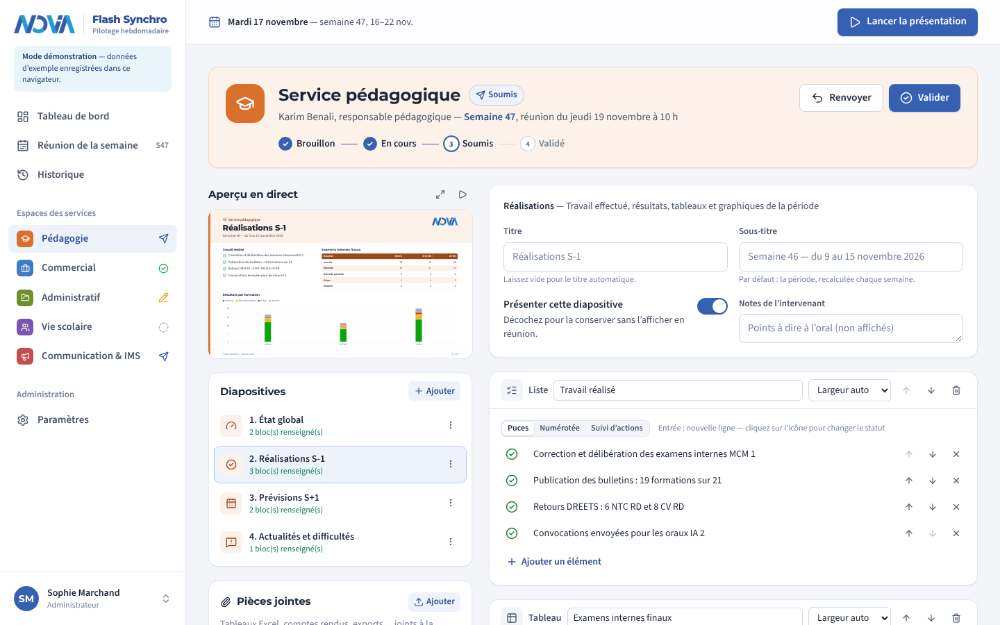
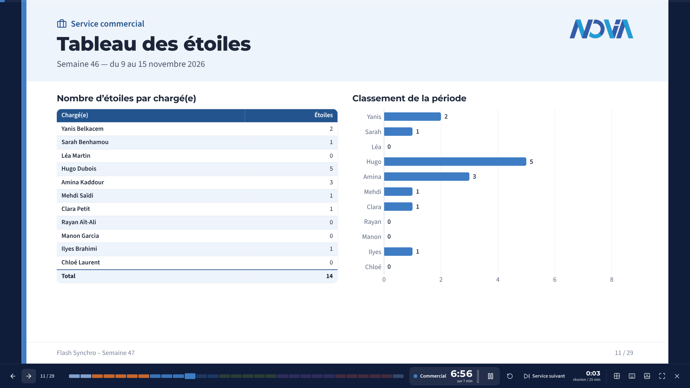

# NOVIA Flash Synchro

Application web de préparation, de présentation et d’archivage de la réunion hebdomadaire **Flash Synchro** de CFA NOVIA.

Chaque service saisit ses informations dans son espace, la direction valide, et la réunion se déroule en plein écran avec un chronomètre par service. Les diapositives sont générées automatiquement à partir des informations saisies, avec le bon numéro de semaine et les bonnes dates.



---

## Sommaire

1. [Fonctionnalités](#fonctionnalités)
2. [Démarrage rapide](#démarrage-rapide)
3. [Démo autonome (sans installation)](#démo-autonome-sans-installation) et [hébergement gratuit](#hébergement-gratuit-sur-claudeai)
4. [Calcul des semaines](#calcul-des-semaines)
5. [Rôles et circuit de validation](#rôles-et-circuit-de-validation)
6. [Mode présentation et chronomètre](#mode-présentation-et-chronomètre)
7. [Connexion à Supabase](#connexion-à-supabase)
8. [Déploiement](#déploiement) et [passage en production sur Cloudflare Pages](#passage-en-production-sur-cloudflare-pages)
9. [Architecture](#architecture)
10. [Tests](#tests)

---

## Fonctionnalités

| Domaine | Ce que fait l’application |
|---|---|
| **Tableau de bord** | Prochaine réunion, semaine en cours, « ruban du temps » (25 min réparties par service), taux de complétion, services en attente avec relance par e-mail, indicateurs clés avec tendance, dernières réunions et durée réelle. |
| **Espaces des services** | Saisie par blocs : indicateurs avec rappel S-1, listes avec suivi (fait / en cours / à faire), tableaux (collage direct depuis Excel, ligne de total automatique), graphiques (barres, empilées, horizontales, courbes, anneau), événements datés, points d’attention avec besoins d’accompagnement, textes et images. Pièces jointes. Aperçu en direct de la diapositive. |
| **Statuts** | Brouillon → En cours → Soumis → Validé. Le responsable soumet ; la direction valide, renvoie avec commentaire ou rouvre. |
| **Diapositives** | Structure du PDF actuel : État global, Réalisations S-1, Prévisions S+1, Actualités et difficultés (+ diapositives libres, comme le « Tableau des étoiles »). L’administrateur ajoute, supprime, masque, réordonne et modifie les modèles. |
| **Présentation** | Plein écran, couverture, ordre du jour avec horaires de passage, ouverture de section par service, transitions, clavier / tactile, vue d’ensemble, progression par service. |
| **Chronomètre** | Compte à rebours par service, démarrer / pause / réinitialiser, service suivant, alerte « bientôt terminé », indicateur de dépassement, chronomètre global, temps réels archivés avec la réunion. |
| **Semaines** | Numéro ISO, dates de début et de fin, périodes S-1 et S+1 calculées automatiquement ; création automatique de la réunion de la semaine ; périodes de 2 à 4 semaines (vacances). |
| **Historique** | Toutes les réunions, consultation de la présentation archivée, duplication vers une autre semaine, exports. |
| **Exports** | PDF (une page 16:9 par diapositive) et PowerPoint **modifiable** (textes, tableaux et graphiques natifs). |
| **Identité visuelle** | Logo NOVIA, bleu NOVIA, typographie Montserrat, couleurs historiques de chaque service (pêche, bleu, vert olive, lavande, vieux rose), palette vérifiée pour la lisibilité et le daltonisme. |



---

## Démarrage rapide

Prérequis : **Node.js 22.12 ou plus récent** (version LTS conseillée).

```bash
npm install
npm run dev
```

Ouvrez http://localhost:5173 et choisissez un profil de démonstration :

| Profil | Rôle | Pour tester |
|---|---|---|
| Sophie Marchand | Administratrice (direction) | Validation, réunions, paramètres, présentation |
| Karim Benali, Laura Fontaine, Thomas Girard, Inès Moreau, Julien Roche | Responsables de service | Saisie, aperçu, soumission |
| Camille Lefèvre | Collaboratrice | Consultation seule |

Le mode démonstration fonctionne **sans serveur** : les données sont enregistrées dans le navigateur. Le jeu de données est recalé sur la date du jour (la réunion de la semaine en cours + 6 réunions archivées, dont une période de deux semaines comme les semaines 42 et 43). Les noms des personnes sont fictifs.

> Astuce : ouvrez la présentation dans un second onglet, modifiez une valeur dans l’espace d’un service : la diapositive se met à jour instantanément.

Pour repartir de zéro : **Paramètres → Données → Réinitialiser la démonstration**.

---

## Démo autonome (sans installation)

```bash
npm run build:demo
```

Produit `dist-standalone/index.html` : un **fichier unique** (polices, logo et bibliothèques inclus) qui s’ouvre par double-clic dans Chrome, Edge ou Firefox, sans connexion internet. Idéal pour une présentation à la direction.

---

## Hébergement gratuit sur claude.ai

```bash
npm run build:artifact
```

Produit `dist-artifact/index.html`, publié comme page hébergée sur claude.ai (privée par défaut ; bouton **Partager** pour l’ouvrir à votre organisation ou par lien). Particularités de cette version :

- les exports PDF et PowerPoint passent par la capacité de téléchargement de la page (le visiteur confirme chaque fichier) ;
- l’adresse de la page ne change pas pendant la navigation (routage interne) ;
- en mode démonstration, les données restent **dans le navigateur de chaque visiteur** : pour un usage d’équipe avec des données communes, connectez Supabase (ci-dessous).

---

## Calcul des semaines

Le calcul suit la norme **ISO 8601** utilisée en France (NF EN 28601) :

- la semaine commence le **lundi** ;
- la semaine 1 est celle qui contient le **premier jeudi** de l’année (donc le 4 janvier) ;
- une année compte **52 ou 53 semaines** (2026 en compte 53 : le 1er janvier 2027 est en semaine 53 de 2026) ;
- la date du jour est lue dans le fuseau **Europe/Paris**.

Pour une réunion de la semaine **S** (exemple : *Flash Synchro – Semaine 47 – du 16 au 22 novembre 2026*) :

| Période | Calcul | Exemple |
|---|---|---|
| Réalisations **S-1** | semaine précédant la réunion (ou 2 à 4 semaines après des vacances) | Semaine 46, du 9 au 15 novembre 2026 |
| Prévisions **S+1** | semaine suivante (réglable : « semaine de la réunion ») | Semaine 48, du 23 au 29 novembre 2026 |
| État global | situation au début de la période de réalisations | Au 9 novembre 2026 |

Les titres et sous-titres des diapositives sont recalculés automatiquement ; ils restent personnalisables. Le calcul est couvert par des tests qui vérifient chaque semaine de 2015 à 2035, et la même logique existe côté base de données (`iso_week_start`).

**Création automatique** : à l’ouverture de l’application, si la réunion de la semaine n’existe pas, elle est créée par duplication de la précédente (les chiffres de la semaine passée deviennent le « rappel », les statuts repartent en brouillon). Jour et heure de réunion, date limite de saisie et seuil d’alerte du chronomètre se règlent dans **Paramètres**.

---

## Rôles et circuit de validation

| Action | Administrateur | Responsable | Collaborateur |
|---|:---:|:---:|:---:|
| Consulter réunions, présentations, historique | ✓ | ✓ | ✓ |
| Saisir le contenu de son service (Brouillon / En cours) | ✓ | ✓ | — |
| Soumettre, reprendre une soumission | ✓ | ✓ | — |
| Valider, renvoyer avec commentaire, rouvrir | ✓ | — | — |
| Créer, dupliquer, supprimer des réunions ; durées | ✓ | — | — |
| Services, modèles de diapositives, utilisateurs | ✓ | — | — |

En mode Supabase, ces règles sont **appliquées par la base de données** (politiques RLS et déclencheurs), pas seulement par l’interface.

---

## Mode présentation et chronomètre



| Touche | Action |
|---|---|
| `→` `Espace` `Page suiv.` / `←` | Diapositive suivante / précédente |
| `Début` / `Fin` | Première / dernière diapositive |
| `1` … `9` | Aller au service n° |
| `N` | Service suivant (bascule aussi le chronomètre) |
| `T` | Démarrer / mettre en pause le chronomètre |
| `R` | Réinitialiser le temps du service |
| `G` | Vue d’ensemble des diapositives |
| `F` | Plein écran |
| `B` | Masquer la barre de contrôle (le chronomètre reste affiché) |
| `Échap` | Quitter |

Le chronomètre passe en **ambre** à l’approche de la fin du temps de parole (60 s par défaut) et en **rouge** en cas de dépassement (« +0:45 »). Il se synchronise avec les diapositives : présenter le service commercial active son compte à rebours. En fin de réunion, **Terminer la réunion** archive les temps réels par service.

---

## Connexion à Supabase

1. **Créez un projet** sur [supabase.com](https://supabase.com) (région Europe conseillée).
2. **Exécutez les scripts SQL**, dans l’ordre, dans *SQL Editor* (ou `supabase db push` avec la CLI) :
   ```
   supabase/migrations/20261117000001_schema.sql
   supabase/migrations/20261117000002_security.sql
   supabase/migrations/20261117000003_storage.sql
   supabase/migrations/20261117000004_weekly_meetings.sql
   supabase/migrations/20261118000005_hardening.sql
   supabase/migrations/20261118000006_table_grants.sql
   supabase/seed.sql              ← services, couleurs, durées et modèles de diapositives
   supabase/demo-data.sql         ← facultatif : 7 réunions de démonstration
   ```
3. **Authentification** (*Authentication → Providers / Settings*) : activez l’e-mail, **désactivez les inscriptions publiques**, puis invitez les personnes (*Users → Invite user*). Le **premier compte créé devient administrateur** ; les suivants sont « collaborateurs ». Indiquez l’URL de l’application dans *URL Configuration* (pour les liens de connexion par e-mail).
4. **Attribuez les rôles** dans l’application (*Paramètres → Utilisateurs et rôles*) : responsable + service pour chaque responsable. Rattachez chaque responsable à son service dans *Paramètres → Services*.
5. **Configurez l’application** : copiez `.env.example` en `.env.local` :
   ```env
   VITE_DATA_MODE=supabase
   VITE_SUPABASE_URL=https://xxxx.supabase.co
   VITE_SUPABASE_ANON_KEY=…   # clé « anon public » (Settings → API)
   ```
6. *(Facultatif)* **Création hebdomadaire côté serveur** : activez l’extension `pg_cron` et exécutez la requête fournie en commentaire à la fin de `20261117000004_weekly_meetings.sql` (chaque lundi à 6 h, heure de Paris). Sans elle, la réunion est créée à la première ouverture de l’application dans la semaine.

Ce qui est inclus côté Supabase : tables et index, sécurité par rôle (RLS), circuit de validation garanti par déclencheurs, profils créés automatiquement à l’invitation, stockage des pièces jointes (privé, liens signés) et des images de diapositives, diffusion en temps réel des modifications (éditeur ↔ présentation), fonction de création des réunions par semaine ISO.

> Les scripts `seed.sql` et `demo-data.sql` sont générés depuis le code (`npm run db:seed`) pour rester cohérents avec l’application.

---

## Déploiement

L’application est un site statique : `npm run build` produit le dossier `dist/`.

- **Vercel** : importez le dépôt ; `vercel.json` est fourni. Ajoutez les variables `VITE_*` dans *Settings → Environment Variables*.
- **Netlify** : `netlify.toml` est fourni (build `npm run build`, dossier `dist`, réécriture vers `index.html`).
- **Autre hébergeur / serveur interne** : servez `dist/` et redirigez toutes les routes vers `index.html` (fichier `public/_redirects` fourni). Sans possibilité de réécriture, construisez avec `VITE_ROUTER=hash`.
- **Cloudflare Pages** : voir ci-dessous.
- **claude.ai** : voir [Hébergement gratuit sur claude.ai](#hébergement-gratuit-sur-claudeai).

Les variables `VITE_*` sont intégrées au moment du build : relancez un build après les avoir modifiées. Garde-fou : si `VITE_DATA_MODE=supabase` est défini sans URL ou clé valide, **le build échoue** au lieu de publier la démonstration.

### Passage en production sur Cloudflare Pages

1. **Variables d’environnement** — déjà fournies pour ce projet dans `.env.production` (URL + clé *publishable*, publique par conception). Pour un autre projet Supabase, modifiez ce fichier ou définissez les variables dans *Workers & Pages → novia-flash-synchro → Settings → Variables and Secrets*, pour **Production** (et Preview si utilisé) :

   | Variable | Valeur |
   |---|---|
   | `VITE_DATA_MODE` | `supabase` |
   | `VITE_SUPABASE_URL` | `https://<ref-projet>.supabase.co` |
   | `VITE_SUPABASE_ANON_KEY` | clé *anon public* / *publishable* (Supabase → Project Settings → API Keys) |

   Jamais la clé `service_role` / *secret* : elle donnerait tous les droits à n’importe quel visiteur.
2. **Build** — commande `npm run build`, dossier `dist`, variable `NODE_VERSION=22` si la version de Node est trop ancienne. Le fichier `public/_redirects` gère les URL de l’application.
3. **Redéployer** — *Deployments → … → Retry deployment* (les variables ne s’appliquent qu’aux nouveaux builds).
4. **Supabase → Authentication → URL Configuration** — *Site URL* : l’adresse publique (ex. `https://novia-flash-synchro.pages.dev`) ; *Redirect URLs* : la même suivie de `/**`. Sans cela, les liens d’invitation et de réinitialisation renvoient vers `localhost`.
5. **Supabase → Authentication → Sign In / Providers** — e-mail activé, *Allow new users to sign up* **désactivé**.
6. **Comptes** — *Authentication → Users → Invite user* : invitez d’abord l’administrateur (le premier compte devient administrateur). Chaque personne clique le lien reçu, arrive connectée dans l’application et choisit son mot de passe. Ensuite : *Paramètres → Utilisateurs et rôles* dans l’application.
7. **Données de démonstration** — si `demo-data.sql` a été exécuté, lancez `supabase/reset-demo-data.sql` avant la mise en service.

Dans l’application : *Mot de passe oublié ?* sur l’écran de connexion, *Changer mon mot de passe* dans le menu du compte (en bas de la barre latérale).

---

## Architecture

```
src/
├── domain/            Règles métier pures, testées
│   ├── isoWeek.ts       Calendrier ISO 8601 (semaines, dates, fuseau Paris)
│   ├── periods.ts       Périodes S-1 / S+1, titres automatiques
│   ├── deck.ts          Génération du déroulé de la présentation
│   ├── meetingFactory.ts Création / duplication d’une réunion
│   ├── permissions.ts   Droits par rôle et par statut
│   └── blocks.ts        Blocs de contenu, totaux, collage Excel, couleurs
├── data/              Accès aux données (interface unique, deux implémentations)
│   ├── repository.ts    Contrat d’accès
│   ├── demoRepository.ts   Mode démonstration (navigateur, synchronisation entre onglets)
│   ├── supabaseRepository.ts  PostgreSQL + Auth + Storage + Realtime
│   ├── catalog.ts       Services, couleurs, durées et modèles par défaut
│   └── demoSeed.ts      Jeu de démonstration inspiré de la Flash Synchro S42-S43
├── store/             État applicatif (zustand) et chronomètre
├── components/
│   ├── slides/          Moteur de diapositives 1920×1080 (couverture, ordre du jour, sections, blocs, clôture)
│   ├── editor/          Éditeurs de blocs
│   ├── presenter/       Chronomètre de séance
│   └── ui/, layout/, brand/, meeting/, dashboard/
├── lib/export/        Export PDF (html-to-image + jsPDF) et PowerPoint natif (pptxgenjs)
└── pages/             Tableau de bord, réunion, espace service, présentation, historique, paramètres
supabase/              Migrations SQL, données initiales, démonstration
scripts/               Génération des données SQL, test de la base
```

Technologies : React 19, TypeScript, Vite, Tailwind CSS 4, Recharts, Supabase, zustand, motion, pptxgenjs, jsPDF.

**Passer du mode démo à Supabase ne demande aucune modification de code** : l’interface ne dépend que du contrat `DataRepository`.

---

## Tests

```bash
npm test          # tests unitaires : semaines ISO (2015-2035), périodes, duplication, déroulé, droits
npm run test:db   # base de données sur PostgreSQL embarqué : migrations, création hebdomadaire, sécurité par rôle
npm run typecheck # vérification TypeScript
```

---

## Personnalisation rapide

- **Durées de parole, couleurs, responsables, ordre des services** : *Paramètres → Services* (et, pour une seule réunion, *Réunion → Réglages*).
- **Structure des diapositives de chaque service** : *Paramètres → Modèles de diapositives*.
- **Jour / heure de réunion, date limite de saisie, alerte du chronomètre, accroche de couverture** : *Paramètres → Réunion et chronomètre*.

Logo et polices : `src/assets/` (Montserrat et Source Sans 3 sous licence SIL Open Font License).
